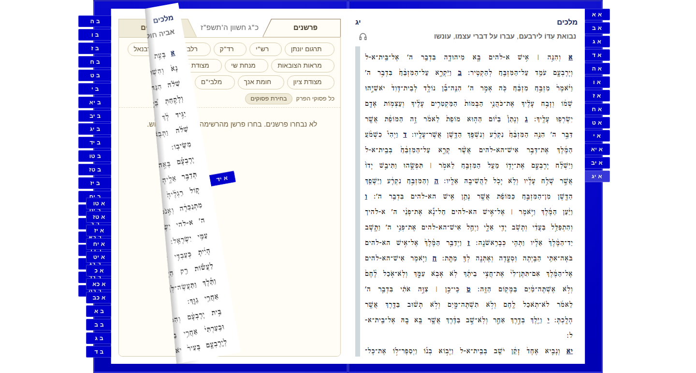

# Prepare bookmark material before insertion

A new moving bookmark surface previously entered the live book before its material, caption and geometry styles were applied. The original tab also received placement styles while it was still connected to its resting rail. Prepare that first pose before insertion instead.

The regression guard bounds changed `writeStyle` calls on connected elements during initial setup to **zero**, in both directions. Its two cases fail on the previous implementation. Existing tests still cover later pose updates, restoration, resizing, custom rendering and interaction.

The [diagnostic record](detached-bookmark-setup.json) retains twenty paired full-reader cases at the original 4x CPU profile and unchanged 200/100/50 ms response/maximum-gap/gap-p95 limits. All pass, including controls. Timing differences are mixed; this run establishes no consistent speedup. Source validation passes 868 unit tests, 56 browser tests with six existing conditional skips and zero retries, and both package builds.

All 24 matching Linux before/after poses preserve every pixel; eight character-position comparisons have zero movement. The comparison used a source-equivalent change in an owned full-content consumer build. This diagnostic record alone does not qualify a published package.

| Before | After |
| --- | --- |
|  |  |
