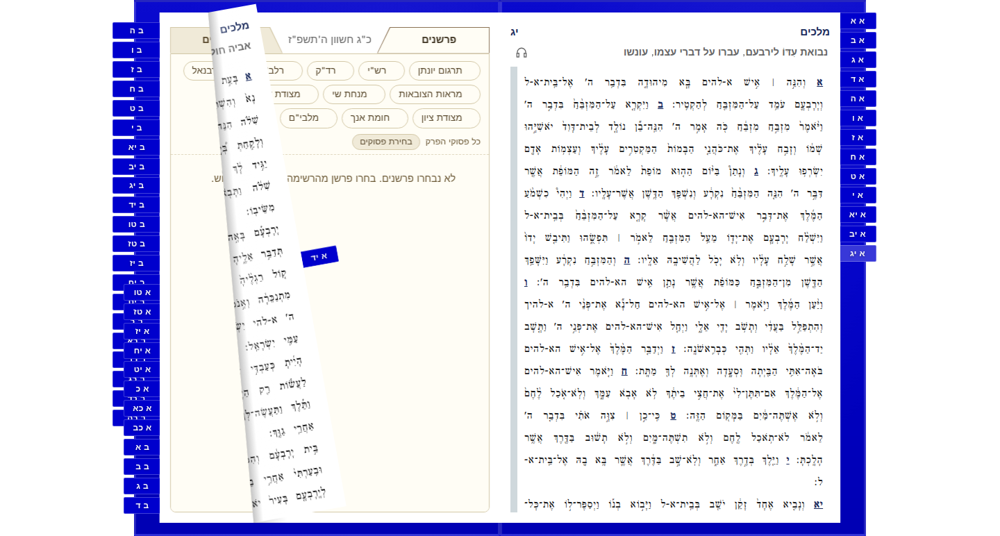

# Keep flat paper in its 2D plane

Paper turns use a 2D crease matrix, then previously switched to a transform containing `rotateY(0deg)` at settlement. Omit that identity rotation for paper. Keep the original translation, reflection, origin, stacking, fold cleanup, callbacks and rigid-cover rotation.

This targets completion work seen in the original failed Bible on Site sequences: [moving bookmarks](https://github.com/bible-on-site/bible-on-site/actions/runs/41969126326/job/127085782226) and pinned bookmarks exceeded the unchanged 50ms browser blocking limit. Their original completion tasks consumed 96.0ms and 134.0ms thread CPU respectively, including style, layout and prepaint. This does **not** explain the earlier untraced 238ms first-turn frame, which remains retained in the consumer's regression fixture.

The [complete diagnostic record](flat-paper-endpoints.json) keeps all nine source-equivalent sequences, their original samples and all 54 completion callbacks. Controls surround the candidate; software CPU throttling remains fixed at 4x, with one worker, zero retries and the same 20s local deadline. Summed completion-task CPU across the three fixtures is 631.4ms before, 591.5ms for the candidate, and 652.9ms after. Response differences are mixed; this establishes no consistent input-latency improvement and is not hosted acceptance evidence.

All 24 matching reader poses preserve every pixel; eight resting character comparisons have zero movement. Fonts, colors, controls, moving bookmarks and held folds remain unchanged. These captures use an explicitly recorded runtime equivalent of the source change; the actual package build and published consumer still require their normal validation.

| Before | After |
| --- | --- |
|  |  |

Unit regression cases first fail on the old implementation. They cover both directions and endpoints, exact translation/reflection, fold cleanup, instant settlement and retained rigid-cover rotation. The full 899-test unit suite, both package builds, 14 paper-fold browser checks and 56 bookmark browser checks pass. One existing conditional bookmark check skips; both browser runs use zero retries. The consumer's fixed performance limits, original samples and three-execution hosted acceptance requirement remain unchanged.
